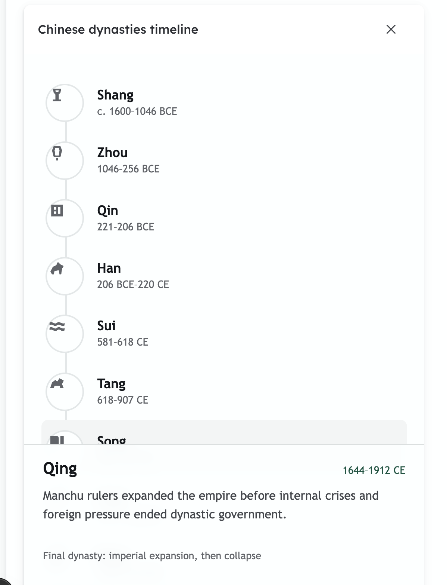

# Chinese dynasties timeline — annotated critique, iteration 2

This review applies to the uncommitted second iteration of the seeded Chinese
dynasties Artifact reviewed in the development gallery on 2026-07-18. Read it with
the [first seed-artifact critique](./2026-07-18-seed-artifact-critique.md) and the
[iteration 3 implementation spec](../CHINESE_DYNASTIES_ITERATION_3_SPEC.md).

## Overall direction

The vertical layout, symbolic markers, concise descriptions, and stable detail dock
improve usability, but the redesign removed too much visual information. Every dynasty
occupies the same height, so a fifteen-year dynasty looks as important and long-lived as
an eight-century dynasty. Monochrome markers also flatten meaningful historical eras.

The next version should restore visual interest through information: proportional time,
semantic era color, hierarchical transition periods, Chinese characters, and polished
symbols. It should not restore the old oversized header, horizontal scroller, nested
cards, or bouncing detail layout.

## Annotated feedback

### Restore information-rich visual character

- The previous timeline was more visually interesting.
- Color-code dynasties by historical family and add an era header for each family.
- Keep the vertical orientation, but put a continuous dated axis on the left.
- Give dynasty spans their actual proportional durations so short and long reigns are
  visibly different.
- Show omitted transition periods briefly, including the Three Kingdoms and later age of
  division between Han and Sui.

### Replace improvised icons with Lucide

- The custom SVG symbols are not polished or consistently centered.
- Add a pinned standalone Lucide browser build to the Artifact sandbox library contract.
- Use a consistent Lucide size and stroke weight inside every timeline marker.
- Center icons by their rendered bounds, not by ad hoc path coordinates.

### Repeat the symbol in selected detail

Repeat the dynasty’s Lucide icon beside its selected-detail heading so the symbol remains
part of the identity after selection. Add the dynasty’s Chinese character beside its
English name.

### Preserve concise prose and remove duplicate chronology

- Keep the concise one-sentence historical description.
- Remove the date from the detail dock because the proportional timeline already displays
  it.
- Replace generic relationship labels such as “Bridge” with the actual historical claim.
  For Sui, explain reunification after the period of division rather than saying only
  “Bridge.”
- Use ordinary semantic HTML for the single Chinese character. Streamdown is unnecessary
  inside the sandbox for this content.

## Accepted decisions from discussion

- Colors encode five historical families rather than assigning ten unrelated hues.
- Every family receives a visible era header.
- Transition periods are selectable.
- Transition periods are visibly subordinate to dynasties and explicitly labeled as
  transitions.
- The Artifact sandbox receives a pinned standalone Lucide build through the same
  allowlist pattern used for KaTeX and Three.js.

## Related workspace feedback

When a Tutor session is opened by initial page load or browser reload, initialize the
session with the sidebar closed. Do not force it closed again after the student manually
reopens it. This is a separate workspace task and is not part of the dynasty Artifact.
