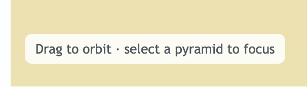
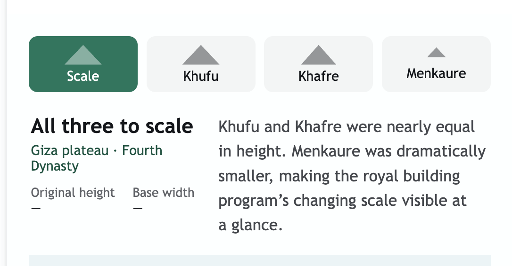
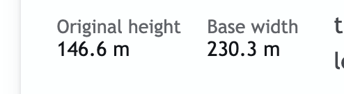
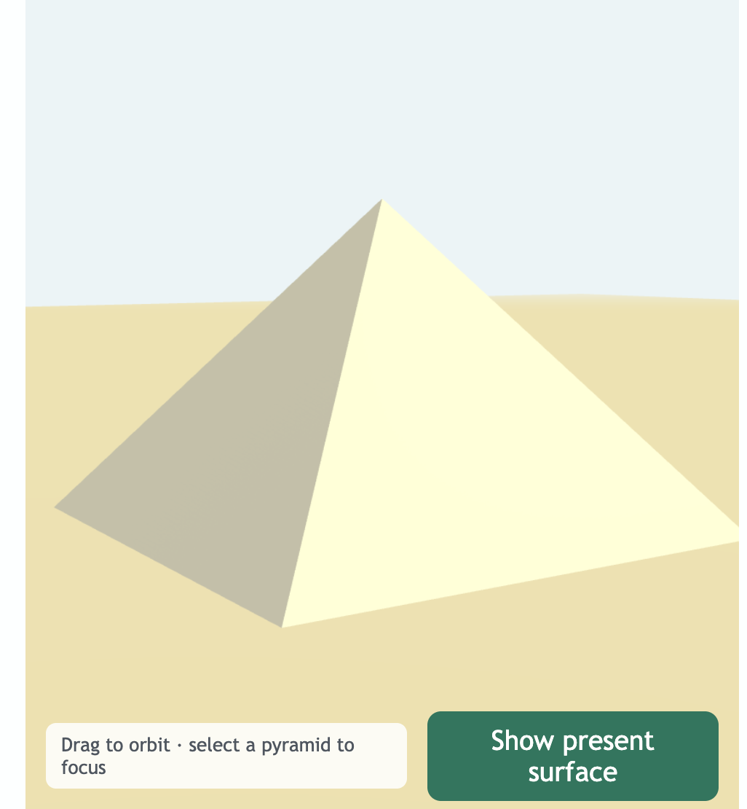
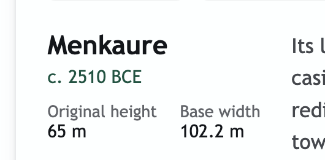
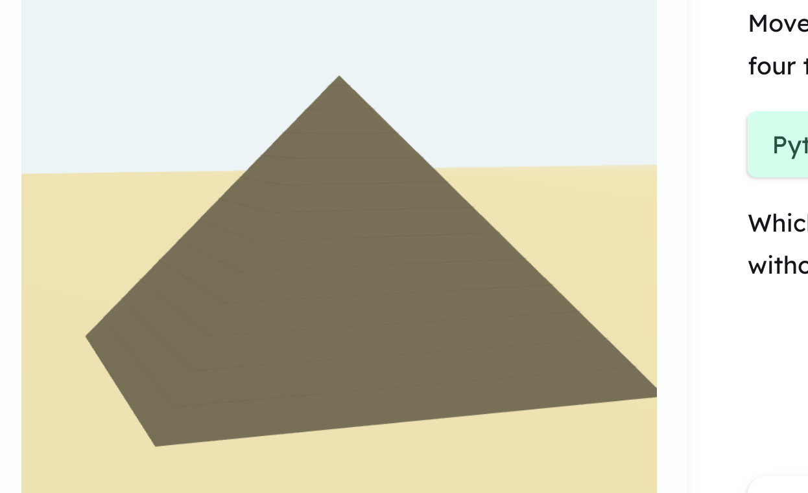
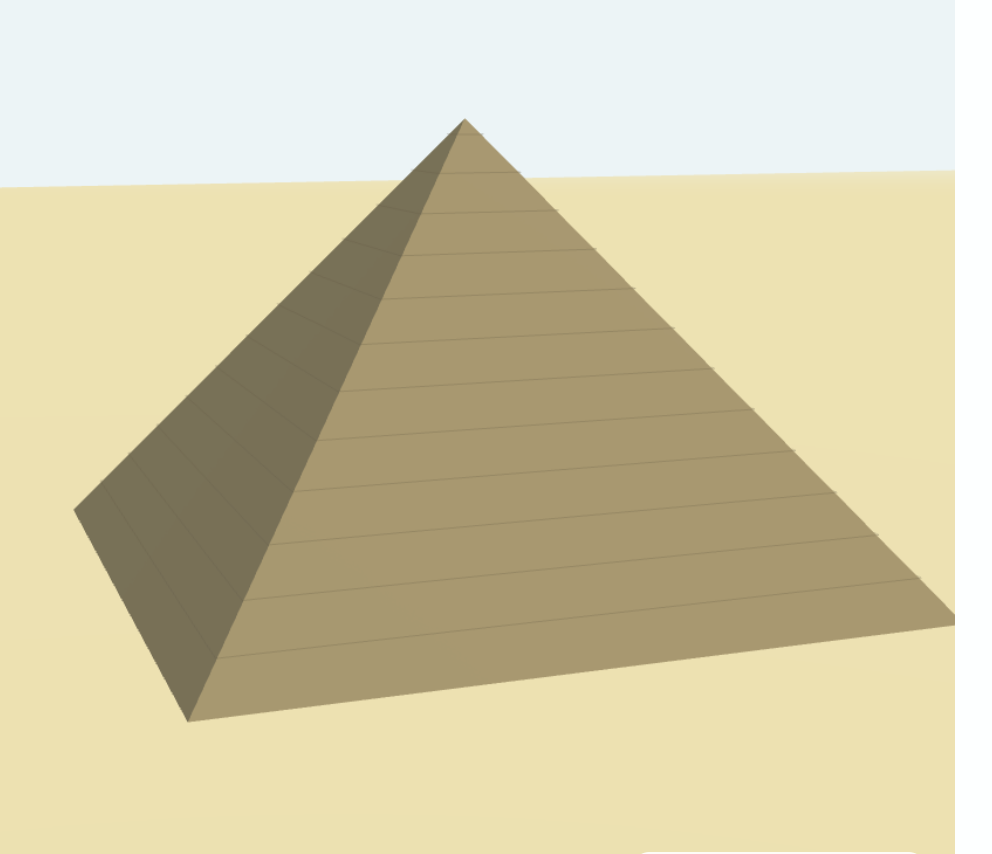
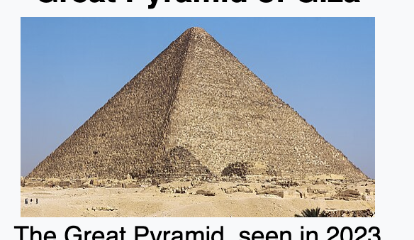
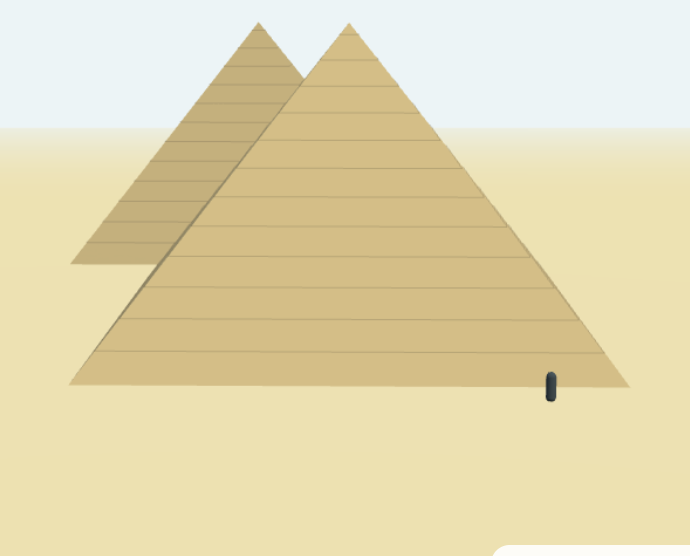

# Egyptian pyramids model — annotated critique, iteration 2

This review applies to the uncommitted second iteration of the seeded Egyptian
pyramids artifact reviewed in the development gallery on 2026-07-18. It should be
read together with the [first seed-artifact critique](./2026-07-18-seed-artifact-critique.md)
and the [iteration 3 implementation spec](../PYRAMID_MODEL_ITERATION_3_SPEC.md).

## Overall direction

The second iteration is substantially better, but it overcorrects toward simplicity.
The next version should remove interface elements that duplicate chat or separate a
control from the object it affects, then spend that recovered attention on a richer,
more legible model. The governing principle is proximity: identify, measure, select,
and inspect each pyramid on the pyramid itself.

## Annotated feedback

### Remove duplicated instructions from the canvas

The “Drag to orbit · select a pyramid to focus” chip is unnecessary canvas chrome.
Explain operation in the adjacent Tutor message instead.

### Remove the redundant whiteboard title

“Egyptian pyramids model” already appears as the Artifact reference in chat. Do not
repeat it as a visible heading above the whiteboard. Keep an accessible name for the
whiteboard region and iframe.

### Replace the detached selector with direct manipulation

Remove the Scale, Khufu, Khafre, and Menkaure menu. Put each pyramid’s name above its
rendered form. Clicking either the model or its label should zoom and center that
pyramid, then progressively disclose its detail.

### Put measurements on the selected pyramid

Do not put original height and base width in a detached definition list. In the
focused view, draw a vertical height measure and horizontal base-width measure against
the selected pyramid.

### Explain the surface comparison in chat

Keep the present/restored surface control on the model, but explain what it changes in
the adjacent Tutor message. The restored state should address the proposed golden tip
as well as the casing. Treat a gold or electrum pyramidion as a reconstruction
hypothesis, not an established fact.

### Put the date beside the historical insight

The focused pyramid’s date should sit inline with its concise historical insight. The
name and dimensions already belong on the model, so a separate identity-and-metadata
column is unnecessary.

### Make the surviving surface materially credible

The lighting and cast shadows are successful and should be retained.

The present surface is still a smooth cone with evenly spaced horizontal lines. Show
the texture, stepped limestone courses, block joints, scale variation, and weathered
irregularity in materially more detail.

Use this photograph as a material and silhouette reference. The goal is not
photorealism at any cost; the goal is to make the construction legible and avoid a
misleading smooth surface.

### Make the scale figure unmistakably human

Retain the human comparison, but use a recognizable low-poly human silhouette with a
head, torso, arms, and legs. It must remain visible without competing with the model.

## Cross-artifact message structure

Seed each Artifact reference in a separate Tutor message. This gives the Tutor enough
room to provide artifact-specific operating instructions and historical framing in the
chat pane while keeping the visualization itself concise.

## Training resources for the review agent

- [Blackboard and Visual AI Tutor Evaluation Metrics](./resources/blackboard-visual-ai-tutor-evaluation-metrics.txt)
- [Imagine — Visual Creation Suite](./resources/imagine-visual-creation-suite-readme.txt)

The reviewer should learn these recurring preferences from both rounds of feedback:

1. The artifact is a teaching instrument, not a miniature web page.
2. Put controls and labels beside the object they affect.
3. Put explanatory prose and operating guidance in Tutor chat.
4. Remove redundant titles, cards, and detached metadata before removing educational
   detail.
5. Progressive disclosure should add specificity after selection, not merely hide
   content.
6. Visual fidelity matters when surface, construction, or scale carries the lesson.
7. Review the artifact inside the real half-pane, not in an isolated full-width demo.
