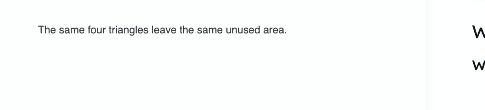
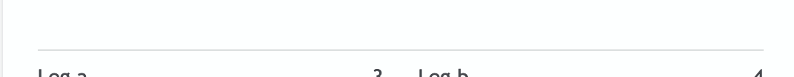
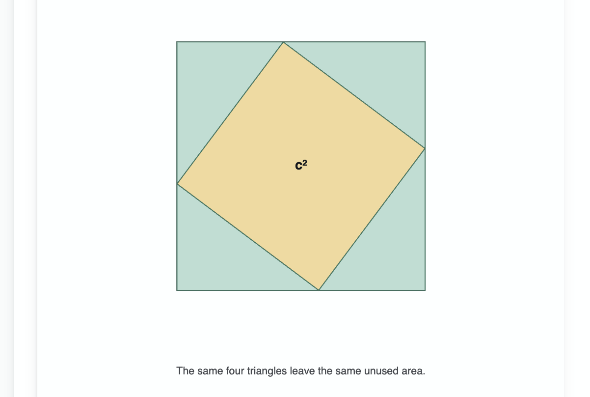

# Pythagorean theorem explorer — annotated critique, iteration 2

This review applies to the uncommitted second iteration of the seeded Pythagorean
theorem Artifact reviewed on 2026-07-18. Read it with the
[first seed-artifact critique](./2026-07-18-seed-artifact-critique.md) and the
[iteration 3 implementation spec](../PYTHAGOREAN_EXPLORER_ITERATION_3_SPEC.md).

## Overall direction

The rearrangement proof is the right mechanism and its animation is successful. The
redesign overcorrected toward simplicity by removing the side labels that connect four
congruent triangles to the equation. The next version should remove redundant prose and
dividers while putting mathematical notation directly on the geometry.

## Annotated feedback

### Remove prose the visual already proves

Remove “The same four triangles leave the same unused area.” The animation should make
that statement self-evident; operating explanation belongs in Tutor chat.

### Remove the decorative divider

Remove the horizontal line above the controls. Use spacing and alignment to separate the
proof from its controls in LearnUnlock style.

### Give the proof more visual area

The outer square should occupy more of the available whiteboard. It should also grow when
both leg values grow instead of being normalized to one fixed size. Explicit bounds must
keep every arrangement, label, and control inside the half-pane.

## Additional feedback

- Put `a = …` and `b = …` directly on the relevant sides of the moving geometry. Include
  `c = …` where it clarifies the hypotenuse.
- The side labels must remain attached during the rearrangement animation; otherwise the
  animation loses its mathematical insight.
- Render all mathematical variables and numeric values with KaTeX, including side labels,
  slider values, residual-area labels, proof-state labels, and the final equation.
- Render the equation in LearnUnlock ink, not green, for maximum readability.
- Preserve the animation timing and geometric rearrangement unless review identifies a
  concrete correctness problem.
