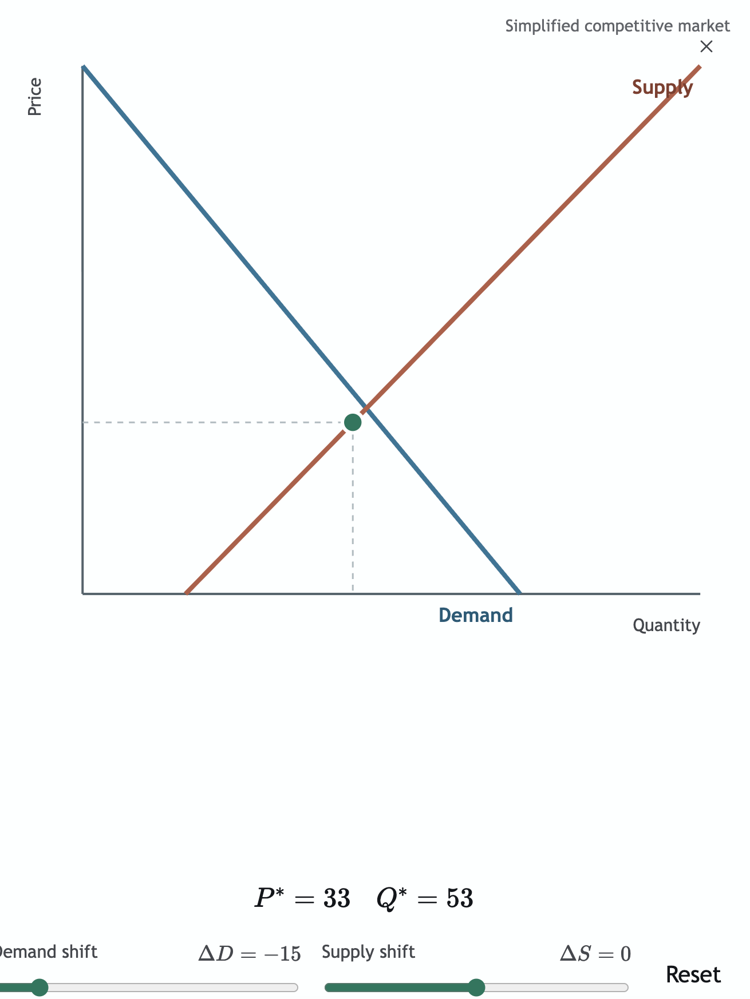
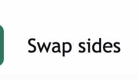

# Market and membrane artifact feedback — 2026-07-25

These notes preserve direct review feedback and the design principles it exposes.

The later July 25 feedback across the full seeded-artifact set is consolidated in
[Seeded artifact design feedback](2026-07-25-seeded-artifact-design-feedback.md).

## Supply and demand explorer

Direct feedback:

- Remove the visible title. The artifact reference and surrounding tutor message already supply context.
- Remove the reset button. It does not reveal new learner information, and the two sliders already express the model's state.
- Keep the equilibrium dot exactly on both displayed curves at every allowed shift. Curve clipping and equilibrium placement must derive from the same equations.
- Prevent overlaps. Reserve the top-right close-control area before placing curve endpoints or labels, and test all meaningful extreme states at supported viewport sizes.
- Use Lexend for diagram text. KaTeX should retain its mathematical typography.
- Keep the artifact canvas white. A black or dark alternate background is unnecessary here.

Generalizable review insight:

- Every visible element must earn its place through learner information, necessary interaction, or essential system control.
- A mathematically correct value is still misleading when it is drawn against geometry generated by a different clipped model.
- Overlay chrome is part of the composition. Artifact content must reserve its space rather than merely render underneath it.

## Cell membrane transport simulator

Direct feedback:

- Remove **Swap sides**. It gives the learner no new information about concentration gradients or membrane permeability.

Generalizable review insight:

- A reversible-looking control is not automatically educational interactivity. Keep an interaction only when changing it reveals a distinct relationship, permits a meaningful experiment, or tests a learner prediction.
- After removing a redundant control, verify that the remaining interactions still expose the complete intended model. Here, concentration establishes the gradient while the channel determines whether diffusion can occur; equal concentrations should explicitly show no net diffusion.

Later calibration added three requirements: keep both sides white, remove the in-artifact
instruction and explanatory conclusion, and animate the existing visible particles through
the channel rather than replacing them at the membrane.
